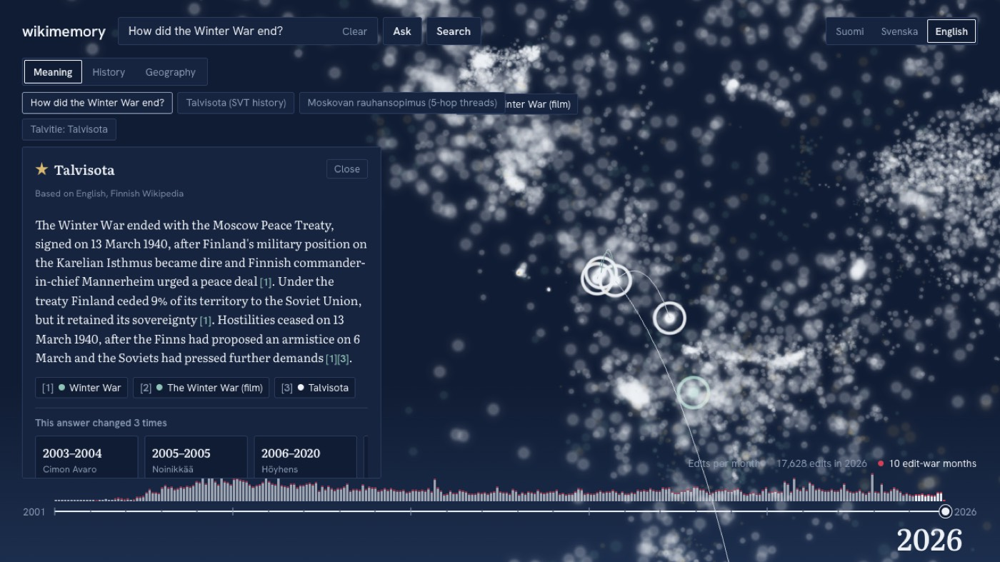
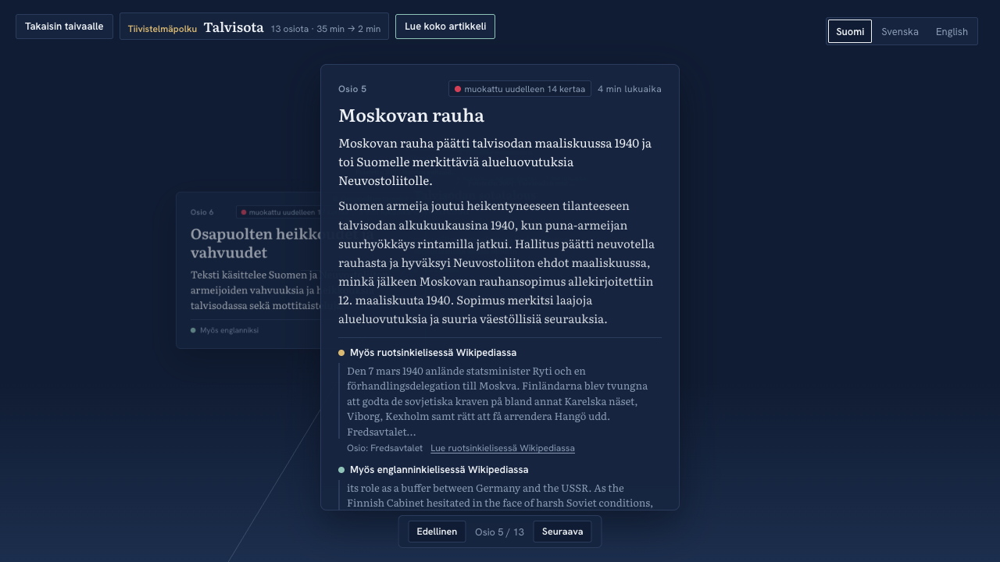
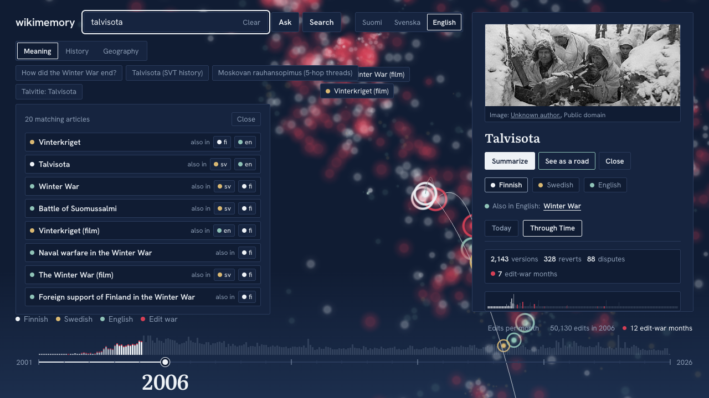
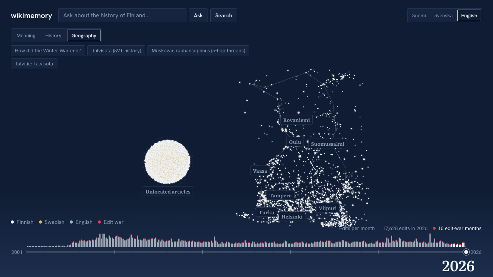
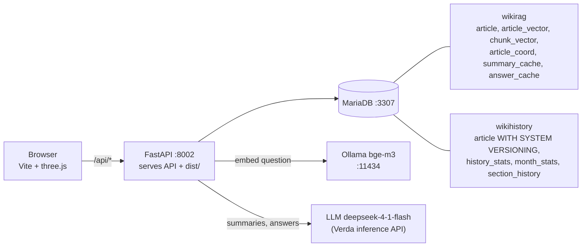

# wikimemory

**Live demo: https://wikimemory.tech**

**Ask Wikipedia a question, then see how its answer changed over the years.**

wikimemory is a 3D galaxy of 29,460 Finnish-history Wikipedia articles (Finnish, Swedish, English). Every star is an article, placed by meaning. Ask a question and you get an answer with cited source sentences. Below it you see how Wikipedia's answer to that question changed, edit by edit, with the revision and the editor behind each change. Vectors find the passage; system versioning shows its past; MariaDB stores all of it, including every LLM answer.

Built for the MariaDB challenge *Wikipedia Through Time* at Junction 2026, on both tracks: **RAG** and **SVT**.



---

## What you can do

| Feature | How it works | MariaDB feature |
| --- | --- | --- |
| **Galaxy.** 29,460 stars (fi 19,285 / sv 4,921 / en 5,254), colour = language. Topics cluster by themselves. | UMAP of the bge-m3 vectors into 3D, stored per article. | `VECTOR(1024)` |
| **Search.** Ask in any language, matching stars light up and the camera flies there. Chips show the same topic in the other languages. | Question embedded with bge-m3, nearest chunks, then joined to the article. | `VECTOR INDEX` (M=16, cosine), `VEC_DISTANCE_COSINE` over 83,797 chunks |
| **Ask, with history.** A short answer from the retrieved passages, every fact with its source sentence. "This answer changed N times": one card per period, with the editor and `oldid` of the edit that changed it. | Current vectors find the articles; each period is rebuilt from the old text. A milestone needs a change in the numbers of the cited sentences, not LLM rewording. | `FOR SYSTEM_TIME AS OF`; vector search and history in one SQL statement (`SINGLE_STMT_HISTORY_SQL`, `backend/ask.py`) |
| **Through time.** Read any article as it stood on any date; versions, reverts, disputes and edit-war months per article; word diff against today. | Real Wikipedia edit times are the row validity times. | `FOR SYSTEM_TIME AS OF` / `ALL`, `system_versioning_insert_history` |
| **Time slider, 2001–2026.** Stars are born in the year their article was created; bars show edits per month; edit-war months turn red. | Read from precomputed tables. | `history_stats`, `month_stats`, `global_month_stats` |
| **Summarize.** One 3D card per section, each fact with its source sentence. Faded cards are sections deleted in the past. | Section history and "ghost" sections are built once from yearly snapshots. | `section_history` (19,285 rows, no LLM, read in < 1 ms) |
| **Cross-language compare.** For each Finnish section, the closest Swedish and English passage ("Also in English Wikipedia" / "Only in Finnish Wikipedia"). | Cosine distance between the chunks of articles with the same `wikidata_id`; match if distance ≤ 0.45. | `VEC_DISTANCE_COSINE` |
| **Memory threads and topic road.** Related articles by vector similarity and shared categories, 13 stations for *Talvisota* (1808–1944), each with similarity, history stats and image credit. | Neighbour search on `article_vector`, filtered by shared category. | `VECTOR INDEX`, category tables |
| **Geography.** Map of Finland, 7,186 stars placed by Wikidata coordinates. | `article_geo` from Wikidata P625 / P276. | plain tables |
| **LLM answers cached in MariaDB.** Summaries and answers are generated once; a cache hit takes 2–7 ms. | `summary_cache`, `answer_cache`. The demo never waits for the model. | tables with a `source_hash` per language row |

Every LLM output comes only from the text it was given. Each fact carries the sentence it came from, the output is JSON with a fixed schema. New answers and translations use `deepseek-4-1-flash` on Verda inference (OpenAI-compatible API); answers cached before 2026-11-15 were written by Anthropic `claude-haiku-5-5`.

### Multilingual: fi, sv, en

The UI and the answers work in all three languages. The rule is **native first, translation second**:

- If a Swedish or English article on the topic exists (same `wikidata_id`), its own summary is the source of truth.
- Otherwise the Finnish result is translated and labelled "Machine-translated from Finnish Wikipedia".
- A translated row stores the hash of the Finnish JSON it came from. If the default row changes, the hash no longer matches and the row is translated again.
- Edit history exists only for Finnish (dataset M), and is labelled "Edit history of Finnish Wikipedia" next to sv and en summaries.
- Switching language inside a Summarize card reopens the matching section in the other language.







---

## Architecture



- `wikirag` and `wikihistory` live on the **same** MariaDB 12.3 server, so one statement can join vector search with `FOR SYSTEM_TIME`.
- Every service binds to `127.0.0.1`. Access from a laptop goes through an SSH tunnel.
- The API contract is `src/api.js` plus `src/mock/contract.test.js`. The same test runs against the mock and against the real API.
- Reused from the organizers (MIT header kept): `rag_common.py`, `svt_common.py`, `history.py` (`as_of`, `versions`, `clean`).

---

## Data

All data comes from the organizers' datasets ([mariadb-wikipedia-datasets](https://github.com/MariaDB/mariadb-wikipedia-datasets)).

| Dataset | What | Loaded |
| --- | --- | --- |
| **S** | 29,460 current articles on the history of Finland (19,285 fi, 4,921 sv, 5,254 en), one bge-m3 vector each, category tree | all |
| **M** | Every saved version of the Finnish articles, 2003 – 1 Oct 2026 | all: **19,742 articles, 862,076 versions** (19,285 of them also in S; 12 listed articles missing from the dumps) |
| **L** | All 568,416 Finnish Wikipedia articles, current text | not used |

What we computed on top:

| Table | Rows / result |
| --- | --- |
| `chunk`, `chunk_vector` | 83,797 chunks (fi 51,541 / sv 11,810 / en 20,446), bge-m3, vector index |
| `history_stats` / `month_stats` / `global_month_stats` | 45,668 reverts, 15,633 disputes, 890 edit-war months; 371,512 + 285 month rows; rebuilt in 79 s |
| `section_history` | 19,285 rows |
| `article_coord` | 29,460 rows (UMAP, 3D) |
| `article_geo` | 7,186 stars with coordinates |
| `article_image` | 15,355 images (52% of stars), Commons only, licence and artist stored |

Join key between the two databases: the Finnish `page_id`. *Talvisota* (Winter War) is `page_id = 1256` in both.

**Definitions.** *Revert*: a version whose `sha1` equals an earlier version but not the previous one. *Dispute*: a revert that undid a named user (not an IP or temporary account). *Edit-war month*: at least 3 disputes. For *Talvisota*: 2,143 versions, 328 reverts, 88 disputes, 7 edit-war months.

**Retrieval evaluation** on the organizers' 37 test questions:

| Retrieval | hit@5 | hit@10 | MRR | latency |
| --- | --- | --- | --- | --- |
| article vectors (baseline) | 76% | 86% | 0.65 | 16.9 ms |
| **chunk vectors (ours)** | **92%** | **95%** | **0.72** | 28.0 ms |
| hybrid with FULLTEXT | 78% | 95% | 0.57 | 606 ms (not used) |

**Research finding.** A `VECTOR INDEX` works on a system-versioned table and `AS OF` uses it (10–13 ms against 1.3–1.6 s for a scan). But HNSW filters `row_start`/`row_end` only after the search, so at AS OF 2015, where 4.3% of rows are live, it found only 5–7 of the exact top 10. We therefore search current vectors and read old text with `AS OF`. Details: `docs/memory/research/wayb-spike.md`.

---

## Run locally

You need Node, Python 3.12, and a MariaDB 12.3 with the `wikirag` and `wikihistory` databases loaded (see *Data*). The databases are too large to ship in the repo.

```bash
# Frontend
npm install
npm run dev            # http://127.0.0.1:5173, proxies /api to 127.0.0.1:8002

# Backend (from the repo root)
python3 -m venv .venv && . .venv/bin/activate
pip install -r backend/requirements.txt
uvicorn backend.main:app --host 127.0.0.1 --port 8002
```

The built frontend is served by the same process: `npm run build`, and FastAPI serves `dist/` at `/`.

Settings are environment variables (or a `.env` next to `backend/rag_common.py`):

| Variable | Default | Meaning |
| --- | --- | --- |
| `DB_HOST`, `DB_PORT`, `DB_USER`, `DB_PASSWORD`, `DB_NAME` | `127.0.0.1`, `3307`, organizers' defaults | MariaDB with both databases |
| `OLLAMA_URL` | `http://localhost:11434` | Ollama with `bge-m3` (embeds the question) |
| `VERDA_API_KEY`, `VERDA_BASE_URL`, `VERDA_MODEL` | none, `https://inference.verda.com/v1`, `deepseek-4-1-flash-1017` | LLM for questions/translations that are not cached yet (set in the backend env file, never in the repo) |
| `LLM_PROVIDER` | `verda` | `anthropic` switches back to the Claude client (`ANTHROPIC_API_KEY`) |
| `ASK_LLM` | `1` | `0` turns LLM calls off (cached answers only) |

Embedding a question needs Ollama with `bge-m3` and options `{"num_ctx": 8192, "num_batch": 8192}`. Do not bulk-embed on a small CPU box: about 3.6 s per 300-word chunk on 2 vCPU.

Without a backend the frontend still runs on mock data: every endpoint has a flag in `src/api.js`, and mock text is marked "[mock]". In the deployed build every endpoint is real except the unused `/api/road`.

The deployed instance runs on an Ubuntu 24.04 VPS (2 vCPU, 8 GB RAM, no GPU). Long jobs run in `tmux new -d -s NAME '...'`.

---

## Test

```bash
npm test                                   # contract test on the mock + i18n + summary mapping (35 pass at last run)
REAL=ask API_BASE=http://127.0.0.1:8002 npm test    # contract test against the real endpoint(s)
python -m pytest backend/test_api.py backend/tests -q   # backend; unit tests are offline, API tests need the databases
BASE_URL=http://127.0.0.1:18322 npm run e2e             # Playwright, 13 flows
```

`npm run e2e` tests the **deployed** build, not `vite dev`. `BASE_URL` defaults to `http://127.0.0.1:18322`, so open an SSH tunnel to the server first:

```bash
ssh -N -L 18322:127.0.0.1:8002 <user>@<server>
```

If the target is not reachable, the test setup stops and prints the tunnel command. The e2e flows cover the sky and search, through time, Ask, Summarize and road, language switch and geography.

Last recorded numbers (see `docs/memory/STATUS.md`): npm test 35/35, VPS pytest 89 passed / 1 skipped at spec 029, e2e 13/13 on the build before the last fixes; dry run 4 on the deployed build had 0 console errors and 0 failed requests. The last bug fix (spec 033) passed 12 of 13 flows on the deployed build; the failing one was the 390 px geography view, which lost the Turku label; its fix was still pending when this was written.

The demo script and its dry runs are in `docs/DEMO.md` and `docs/memory/research/`.

---

## Known limits

- **Compare recall is 0.782** (precision 0.984, 130 hand-labelled pairs, threshold 0.45): about 1 in 5 real matches is missed.
- **Change detection uses numbers only.** Edits that change only names or wording are missed, so an Ask answer can show fewer periods than there were edits.
- **Cold cache.** The first click on *As of*, the diff card or a new question can take 1–3 s (a brand-new, uncached question about 25 s). Warm calls are 100–300 ms.
- **Map labels on very narrow screens.** Geography is readable at 390 px, but some city labels can still collide with the legend there.
- History exists only for Finnish. Swedish and English summaries show the Finnish history.
- Some demo questions retrieve the wrong top article (32, 34, 39 in `data/demo-questions.tsv`).
- Short articles (under 1,500 words or fewer than 4 sections) get an overview without section cards.
- Languages can differ: the English answer says "13 March 1940" for the treaty while the Finnish edit history shows 12 March; the Swedish hero answer has 4 changes, the English and Finnish 3. Both are real article history.

---

## Credits and licence

- Data: Wikipedia, under [CC BY-SA 4.0](https://creativecommons.org/licenses/by-sa/4.0/). Every result links back to its article or version (`?curid=` / `?oldid=`). Anything derived from the text, including vectors and coordinates, is shared under the same licence.
- Images: Wikimedia Commons only. The artist and licence of each image are shown in the UI (for example "Image: Imonoz, CC BY-SA 4.0").
- Datasets and reference code: [MariaDB Foundation](https://mariadb.org/) (Robert Silén), MIT licence: [mariadb-wikipedia-datasets](https://github.com/MariaDB/mariadb-wikipedia-datasets), [mariadb-vector-wikipedia-rag](https://github.com/MariaDB/mariadb-vector-wikipedia-rag), [mariadb-system-versioning-wikipedia](https://github.com/MariaDB/mariadb-system-versioning-wikipedia). Files copied from them keep their licence notice.
- Embedding model: [BAAI/bge-m3](https://huggingface.co/BAAI/bge-m3) via [Ollama](https://ollama.com/). Answers: `deepseek-4-1-flash` on Verda inference (earlier cached answers: Anthropic `claude-haiku-5-5`). 3D: [three.js](https://threejs.org/).
